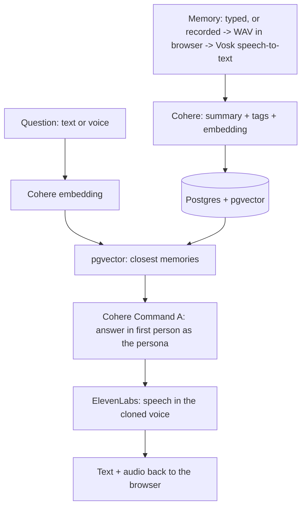

# 🎙️ SwarSmriti – Preserving Memories with AI

> Voice your legacy. Immortalize memories. Speak to tomorrow.

## 🧠 Concept

**SwarSmriti** is an AI voice memory assistant that preserves the voice and thoughts of a loved one. You:

* Add **everyone you want to remember**: a grandparent, a parent, a friend. Each person has their own portrait, memories and voice.
* Tell it **who** the person is (name, how they talk) and optionally **clone their voice** from old recordings.
* **Train** it with memories, typed or spoken.
* **Talk** to it by text or voice. It answers in the first person, grounded only in the shared memories, in their voice.

It is honest by design: it never invents personal facts that aren't in the memories, and if someone sincerely asks, it says it is an AI made from those memories.

---

## 🔁 How it works



---

## 🛠️ Tech Stack

**Backend** (`backend/`): FastAPI · Postgres + pgvector (e.g. free [Neon](https://neon.com)) · Cohere (Command A chat, Embed v4) · ElevenLabs (TTS + Instant Voice Cloning) · Vosk (offline speech-to-text)

**Frontend** (`frontend/`): React + TypeScript · Vite · Tailwind CSS · lucide-react

**Hosting:** Render (backend web service + static site)

```
backend/
├── main.py              # app setup, CORS, error handling, /health
├── config.py            # every setting, read from environment variables
├── db.py                # Postgres + pgvector: people, their memories, activity
├── errors.py            # ServiceError -> clean JSON error responses
├── routes/              # HTTP endpoints (people, train, chat, memories, transcribe)
├── services/            # outside services: cohere, elevenlabs, speech (vosk), persona (the "brain")
└── vosk_model/          # small English speech model
frontend/src/
├── context/             # PersonContext: who is being remembered right now
├── pages/               # Home, Family, Portrait, Add a memory, Talk, Album
├── components/          # Layout, AudioPlayer, ChatBubble, VoiceRecorder, MemoryCard
├── services/api.ts      # every call to the backend
└── utils/audio.ts       # recording -> WAV conversion in the browser
```

---

## 🧪 Run it locally

**Prerequisites:** Python 3.13, Node.js 18+, a Postgres database with pgvector (a free Neon project works), Cohere + ElevenLabs API keys.

### Backend

```bash
cd backend
python -m venv venv
source venv/bin/activate          # Windows: venv\Scripts\activate
pip install -r requirements.txt
cp .env.example .env              # then fill in DATABASE_URL, COHERE_API_KEY, ELEVENLABS_API_KEY
uvicorn main:app --reload
```

Tables are created automatically on first start. API docs: http://localhost:8000/docs

### Frontend

```bash
cd frontend
npm install
cp .env.example .env.local        # points the app at http://localhost:8000
npm run dev
```

> 🔐 Never commit `.env` files with real keys. They are git-ignored; on Render, set keys in the service's **Environment** tab.

---

## 🚀 Deploy (Render)

| Service | Setting | Value |
| --- | --- | --- |
| Backend (web service) | Root directory | `backend` |
| | Build command | `pip install -r requirements.txt` |
| | Start command | `uvicorn main:app --host 0.0.0.0 --port $PORT` |
| | Environment | `DATABASE_URL`, `COHERE_API_KEY`, `ELEVENLABS_API_KEY` |
| Frontend (static site) | Root directory | `frontend` |
| | Build command | `npm ci && npm run build` |
| | Publish directory | `dist` |
| | Redirects/Rewrites | Source `/*` → Destination `/index.html`, Action **Rewrite** |

The free backend sleeps after 15 minutes idle; the frontend shows "Waking server…" while it starts (about a minute).

**Live demo:** https://swarsmriti-1.onrender.com · **Demo video:** https://www.youtube.com/watch?v=xN1qYtvx7gQ

---

## 👥 Team

| Name | Role | Contributions |
| --- | --- | --- |
| **Arpit Makkar** | Backend Integration & Deployment | FastAPI APIs, Vosk STT, ElevenLabs, memory store |
| **Keshav Sharma** | Frontend Integration & Deployment | React UI, audio capture, API connectivity, hosting |

---

## 📌 Acknowledgements

[Vosk](https://alphacephei.com/vosk/) · [Cohere](https://cohere.com/) · [ElevenLabs](https://elevenlabs.io/) · [pgvector](https://github.com/pgvector/pgvector) · [Render](https://render.com/docs)